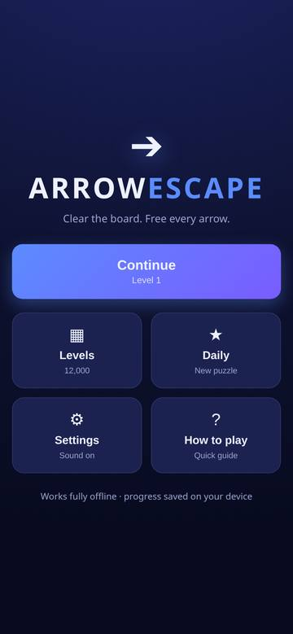
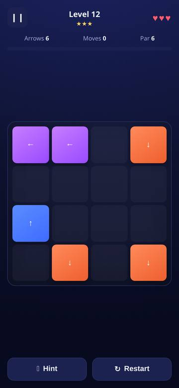

# Arrow Escape

A clean, offline, mobile-first **arrow-clearing puzzle game** built with plain
HTML5 + CSS3 + vanilla JavaScript. Every arrow points up, down, left or right;
tap an arrow to send it off the board - but only if its whole lane to the edge is
clear. Clear the board without losing all your hearts.

**12,000 levels**, all generated and verified solvable.




## Play

Open `index.html` in any modern browser, or serve the folder:

```bash
python3 -m http.server 8000
# then visit http://localhost:8000
```

No build step, no dependencies, no network needed once the files have loaded.

## Rules

1. Each arrow occupies one cell and points **N / E / S / W**.
2. Tapping an arrow removes it **only if every cell from it to the board edge,
   in its direction, is free of other arrows**.
3. If something blocks the lane, the arrow shakes and you **lose one heart**.
4. Clear **every** arrow to finish the level.
5. You have **3 hearts**; lose them all and the level restarts.
6. **Hint** highlights an arrow you can remove right now. **Restart** resets the
   level. **Continue** moves to the next level.

## Features

- Responsive board (3x3 up to 9x9) that scales to any phone, tablet or desktop.
- 12,000 levels with a gradual difficulty ramp: **levels 1-5** are a tutorial,
  **6-24** ramp up gently (4x4 -> 6x7 boards), and **from level 25 onward every
  level is high-difficulty mode** (7x7 -> 9x9 boards with dense arrows).
- Hearts, remaining-arrow counter, move counter, par, and a level progress bar.
- Stars (3 / 2 / 1) based on how many mistakes you made.
- Hint, Restart, and a Pause menu (Resume, Restart, Sound, Home).
- Arrow exit animations, shake feedback, heart-loss feedback, confetti on a win.
- Sound effects (Web Audio, no asset files) and haptic feedback, both toggleable.
- **Daily Puzzle** - a fresh deterministic puzzle every day.
- Level unlocking, per-level stars, and progress saved in `localStorage`.
- **Optional online packs** - fetch extra levels from GitHub with one tap, no new
  build needed. This is the only network use in the whole game.
- Works fully **offline**; no account, no ads, no tracking.

## Project layout

```
index.html            the whole game shell (screens + overlays)
css/style.css         responsive, mobile-first styling
js/core.js            pure puzzle logic + deterministic level generator
js/levels.js          level-catalogue metadata (12,000 levels)
js/game.js            UI, flow, progress, sound, effects, online packs
js/playables.js       YouTube Playables SDK shim (no-op off YouTube)
packs/                optional downloadable packs + manifest.json
docs/PACKS.md         how the online pack system works
docs/PLAYABLES.md     how the game runs on YouTube Playables
tools/generate_levels.py   Python generator (mirror of the JS generator)
tools/verify_levels.py     validates every level (solvability + integrity)
tools/dump_levels.js       dumps all generated levels to JSON for validation
tools/build_pack.js        builds a downloadable pack of fresh levels
tools/build_bundle.sh      builds the Playables upload bundle
tools/check_bundle.py      validates a bundle against the Playables limits
tools/test_core.js         headless logic tests
```

## How the levels are made

Levels are **generated, not hand-drawn**, and every one is **solvable by
construction**. The generator places arrows one at a time onto an empty board and
requires each new arrow's lane to be clear of everything already placed. The
reverse of that placement order is therefore a valid clearing order - so a level
can never be impossible.

Because generation is deterministic (`mulberry32` seeded from the level id), the
12,000 levels need no bulky data files: `APCore.generate(id)` reproduces level
`id` exactly, on any device.

### Verifying the levels

```bash
node tools/dump_levels.js 12000 levels.json   # dump the exact levels
python3 tools/verify_levels.py levels.json     # check every one
node tools/test_core.js                        # headless logic tests
```

The validator checks that no two arrows share a cell, all arrows are in bounds,
directions are valid, `par` matches the arrow count, and the board can actually be
cleared. Last run: **12,000 / 12,000 levels solvable, 0 failures.**

### Adding your own levels

- **Change the catalogue size / curve** in `js/core.js` (`SIZES`, `HARD_EVERY`,
  `HIGH_FROM`, `params()`), or in `js/levels.js` (`total`, `hardEvery`,
  `highFrom`). Raise or lower `HIGH_FROM` to move the point where high-difficulty
  mode begins.
- **Add a handcrafted level**: build an `{ rows, cols, arrows:[[r,c,d],...], par }`
  object and return it from a small override table keyed by id.
- **Bake static data instead of generating at runtime**: run
  `node tools/dump_levels.js 12000 levels.json` and load that JSON, if you prefer
  shipping a data file to shipping a generator.

## Optional online packs (new levels without a new build)

Because the game is a static site, you can publish **new levels later without
shipping a new build** - players pick them up from inside the game.

- The **Packs** tile opens the pack screen; **Check for new packs** fetches
  `packs/manifest.json` from this repo and installs any newer packs.
- Packs are validated level by level before they are kept, so a bad or hostile
  pack can never create an unsolvable level or run code.
- Everything else stays offline: if the fetch fails, the built-in levels and any
  installed packs keep working.

To publish a pack:

```bash
node tools/build_pack.js --id winter-event --name "Winter Event" \
  --count 40 --rows 7 --cols 7 --arrows 22 --seed 70001 packs/winter-event.json
# then add it to packs/manifest.json (with a version) and commit
```

See [`docs/PACKS.md`](docs/PACKS.md) for the manifest and pack formats.

## YouTube Playables

The game is wired for YouTube Playables: the SDK loads before any game code, the
required calls are made (`firstFrameReady`, `gameReady`, `loadData`/`saveData`
cloud save, `onPause`/`onResume`, mute handling), dialogs close with `Esc`, and
it stays responsive in every aspect ratio. Outside YouTube the SDK is a no-op, so
the same build still runs on the web.

```bash
bash tools/build_bundle.sh          # stages + zips the runtime files
python3 tools/check_bundle.py build/playables   # validates against the limits
```

Inside Playables the online-pack feature is disabled (Playables allows no
external calls) - all levels are built in. See [`docs/PLAYABLES.md`](docs/PLAYABLES.md).

## Package as an Android app (optional)

The game is a static site, so any WebView wrapper works. With
[Capacitor](https://capacitorjs.com/):

```bash
npm init -y
npm install @capacitor/core @capacitor/cli @capacitor/android
npx cap init "Arrow Escape" com.example.arrowescape --web-dir=.
npx cap add android
npx cap sync
npx cap open android      # build + run from Android Studio
```

Or with [Cordova](https://cordova.apache.org/) (`cordova create`, copy these
files into `www/`, `cordova platform add android`, `cordova run android`).

## Deploy online

Any static host works - it is just files:

- **GitHub Pages**: repo Settings -> Pages -> deploy from the `main` branch root.
- **Netlify / Vercel / Cloudflare Pages**: drag the folder in, no build command.

## License

MIT - see [LICENSE](LICENSE). Original work; not affiliated with any other game.
